<div align="center">



# 🛡️ Awesome Agent Identity Verification & IAM Systems 🤖

**The Definitive Curated Directory of SaaS Platforms, Open-Source Infrastructure, Protocols, and Architectural Standards for Autonomous AI Agent Identity, Non-Human Identity Management (NHI), and Delegated Authorization.**

<p align="center">
  <a href="https://github.com/ishandutta2007/Awesome-Awesome-Awesome"></a><a href="https://discord.gg/jc4xtF58Ve"></a>
  <a href="https://github.com/ishandutta2007/Awesome-Agent-Identity-Verification-IAM-Systems/stargazers"></a>
  <a href="https://github.com/ishandutta2007/Awesome-Agent-Identity-Verification-IAM-Systems/network/members"></a>
  <a href="https://github.com/ishandutta2007/Awesome-Agent-Identity-Verification-IAM-Systems/issues"></a>
  <a href="https://github.com/ishandutta2007/Awesome-Agent-Identity-Verification-IAM-Systems/blob/main/LICENSE"></a>
  <a href="https://github.com/ishandutta2007/Awesome-Agent-Identity-Verification-IAM-Systems/pulls"></a>
  <a href="https://github.com/ishandutta2007"></a>
</p>

---

*Curated with precision for Security Architects, AI Platform Engineers, DevSecOps Leaders, and Identity Practitioners.*

</div>

## 📑 Table of Contents

- [🌐 Executive Overview](#-executive-overview)
- [📈 Sector Overview & Market Dynamics](#-sector-overview--market-dynamics)
- [☁️ Enterprise SaaS & Hosted Platforms](#️-enterprise-saas--hosted-platforms)
- [💻 Open-Source GitHub Projects](#-open-source-github-projects)
- [📜 Open Standards, RFCs & Protocols](#-open-standards-rfcs--protocols)
- [🏗️ Architectural Reference Blueprint](#️-architectural-reference-blueprint)
- [🤝 How to Contribute](#-how-to-contribute)
- [💖 Support](#-support)
- [📈 Star History](#--star-history)
- [⚖️ Disclaimer](#️-disclaimer)

---

## 🌐 Executive Overview

As autonomous AI agents, LLM tool-calling routines, and Model Context Protocol (MCP) servers rapidly proliferate into production systems, organizations face a generational identity security paradigm shift: **machine and agent identities outnumber human identities by over 20-to-1**.

Traditional Identity & Access Management (IAM) systems designed exclusively for human interactive sessions (passwords, browser cookies, interactive MFA) cannot satisfy the demands of autonomous software actors. **Agent Identity Verification & IAM Systems** solve this critical gap by treating AI agents as verifiable, first-class non-human entities equipped with:

- 🪪 **Cryptographic Identity Attestation**: Ed25519 / X.509 SVID credentials and W3C Verifiable Credentials (VCs).
- 🔐 **Delegated Authorization & Scoping**: Dynamic Client Registration (DCR), OAuth 2.1, Token Exchange (RFC 8693), and Task-Based Access Control (TBAC).
- 🛡️ **Model Context Protocol (MCP) Security**: Least-privilege authorization policies governing tool invocation, external API access, and database interactions.
- 📋 **Tamper-Evident Auditability**: Cryptographically verified audit logging answering *"Which agent acted on whose behalf, under what authority, and to what boundary?"*

---

## 📈 Sector Overview & Market Dynamics

The global Identity and Access Management (IAM) market is estimated at **$18.5 Billion in 2025** and is projected to expand past **$41.5 Billion by 2030** (~17.5% CAGR). Within this space, the specialized **Non-Human Identity (NHI) and AI Agent IAM sector** represents one of the fastest-accelerating security frontiers—valued at approximately **$2.8 Billion in 2025/2026** and forecasted to eclipse **$14.2 Billion by 2032** at an extraordinary **31.4% CAGR**, spurred by the exponential deployment of agentic workflows and multi-agent microservices.

In terms of industry concentration, the market currently exhibits a **bimodal structure with moderate fragmentation at the developer/innovation layer and high concentration (winner-take-most) at the enterprise governance platform layer**:
- **Innovation & Developer Gateway Tier (Moderately Fragmented)**: Agile, venture-backed developer-first authentication platforms (e.g., Descope, WorkOS, Clerk) are competing vigorously to establish the de facto runtime protocol standards for MCP authorization, dynamic client registration, and local agent credentialing.
- **Enterprise Core Governance Tier (Concentrated / Winner-Take-Most)**: Established cybersecurity and enterprise IAM giants (Okta, CyberArk, Palo Alto Networks, Ping Identity/ForgeRock) possess insurmountable enterprise sales moats, deep compliance accreditations (FedRAMP, SOC2 Type II, ISO 27001), and multi-billion-dollar balance sheets. These incumbents are aggressively pursuing acquisitions (e.g., Palo Alto acquiring CyberArk for $25B, Okta acquiring Auth0 for $6.5B, Twilio acquiring Stytch) to absorb innovative point solutions into unified, single-pane-of-glass human and agent identity fabrics.

---

## ☁️ Enterprise SaaS & Hosted Platforms

The following hosted SaaS platforms provide managed identity, authentication, credential lifecycle management, and delegated authorization frameworks for AI agents and machine workloads.

> [!NOTE]
> Platforms are sorted in **descending order by company scale** (Market Capitalization / Enterprise Valuation / Annual Recurring Revenue).

| 🏢 Platform | 💰 Company Scale (Valuation / Revenue) | 🏷️ Starting Pricing | 🎁 Free Tier / Trial Limits | 🛡️ Agent Identity & IAM Capabilities |
| :--- | :--- | :--- | :--- | :--- |
| **[Okta](https://www.okta.com/)** | **~$38.5B Market Cap**<br>*(~$2.7B - $3.0B TTM Revenue)* | **$6.00 / user / month**<br>*(Workforce Identity Cloud Starter, billed annually, $1,500/yr min contract)* or **$23.00 / month** *(Customer Identity Essentials)* | **Free Forever Developer Edition**: Up to 7,500 MAU forever, or **30-Day Free Trial** for Workforce Identity (up to 50 test users & adaptive MFA) | 🤖 Cross-App Access for delegated agent authorization; dynamic token exchange; automated agent directory lifecycle governance; ISG 2026 Non-Human Identity Leader. |
| **[CyberArk](https://www.cyberark.com/)** | **~$25.0B Valuation**<br>*(Acquisition by Palo Alto Networks; $20.7B Market Cap; ~$1.34B ARR)* | **$5.00 / user / month**<br>*(CyberArk Identity Workforce SSO & MFA starter tier)* or **$3,500 / year base** for Conjur Enterprise Secrets | **30-Day Free Evaluation Proof-of-Concept** (or 14-day dedicated virtual sandbox lab supporting up to 100 endpoints and machine workloads) | 🔐 Conjur secretless machine-to-machine identity broker; Venafi PKI certificate-based workload credentialing; privileged agent session monitoring and credential rotation. |
| **[Auth0](https://auth0.com/)** *(by Okta)* | **$6.5B Valuation**<br>*(Acquired by Okta; operates as Okta Customer Identity Cloud)* | **$23.00 / month**<br>*(B2C Essentials plan up to 1,000 MAU)* or **$130.00 / month** *(B2B Starter plan up to 1,000 MAU)* | **Free Forever Plan**: Up to 7,500 MAUs, unlimited logins, up to 3 external social/enterprise identity connections, and custom Extensibility Actions | ⚡ Spec-compliant OAuth 2.1, Dynamic Client Registration (DCR), PKCE, and JWKS discovery for MCP servers; custom Actions for routing agent client registrations to specific tenants. |
| **[Ping Identity](https://www.pingidentity.com/)** | **~$2.8B Valuation**<br>*(Acquired by Thoma Bravo; ~$800M - $1.0B combined ARR post-ForgeRock)* | **$3.00 / user / month**<br>*(PingOne Workforce Identity starter tier)* or **$20,000 / year base** for PingOne Customer Identity (CIAM) | **30-Day Free Trial**: Supports up to 5 sandbox environments and up to 1,000 active test identities with full SSO, MFA, and API governance features | 🌐 Agentic IAM suite (launched 2026); decentralized identity verifiable credentials; zero-trust contextual authorization and dynamic risk-signal scoring. |
| **[WorkOS](https://workos.com/)** | **$2.0B Valuation**<br>*(Series C $100M raised March 2026; $196M total raised; ~$30M ARR)* | **$49.00 / month base + $0.025 / MAU**<br>*(AuthKit Scale tier)* or **$125.00 / connection / month** for Enterprise SAML SSO / SCIM Directory Sync | **Free Forever Plan**: AuthKit is 100% free forever for up to 1,000,000 MAUs, including user management, passkeys, and 1 enterprise SSO connection | 🤖 Spec-compatible OAuth 2.1 authorization server for Model Context Protocol (MCP); Dynamic Client Registration (DCR), PKCE token exchange, and standalone Connect. |
| **[Beyond Identity](https://www.beyondidentity.com/)** | **$1.1B Valuation**<br>*(Series C $100M led by Evolution Equity; $205M total raised; ~$38M ARR)* | **$3.00 / user / month**<br>*($36/user/yr with 25-seat min commitment of $900/yr)* for Secure Workforce MFA, or **$0.03 / MAU** for Secure Customers | **30-Day Free Trial**: Full-featured access for up to 25 users/workloads with hardware-bound cryptographic key verification and continuous posture validation | 🛡️ Passwordless, cryptographic hardware-bound credentials; secretless agent-to-service authentication; continuous zero-trust risk posture validation for automated processes. |
| **[Stytch](https://stytch.com/)** | **$1.0B Valuation**<br>*(Acquired by Twilio in late 2025; $146M venture funding raised prior)* | **$99.00 / month**<br>*(B2B Starter plan for 1,000 MAU + 5 SSO connections)* or **$0.02 / MAU** *(Consumer pay-as-you-go)* | **Free Forever Plan**: Up to 10,000 MAUs, 25 M2M/agent client credentials, and 100 free SMS OTP authentications/month | 🔗 "Connected Apps" agent identity framework with OAuth 2.1, dynamic client registration (DCR), RBAC tool scopes, and human-in-the-loop device approvals. |
| **[Clerk](https://clerk.com/)** | **~$650M Valuation**<br>*(Series C $50M in Oct 2025 led by Menlo & Anthropic; $105M+ raised; ~$29M ARR)* | **$25.00 / month**<br>*(Clerk Pro plan, covers first 10,000 MAU, then $0.02 / additional MAU)* | **Free Forever Plan**: Up to 10,000 MAUs, unlimited authentication requests, standard MFA, and community support | ⚡ OAuth 2.1 with public JWKS discovery; native Agent Identity primitives for Next.js, Node.js, and React; seamless MCP middleware authentication. |
| **[Descope](https://www.descope.com/)** | **~$500M Valuation**<br>*($88M total seed/extension funding led by Lightspeed & Notable Capital)* | **$99.00 / month**<br>*(Descope Pro tier base with custom domain and advanced RBAC, then $0.05 / MAU)* | **Free Forever Plan**: Up to 7,500 MAUs, 2,000 agent authorizations/consents, 2,000 M2M tokens, and unlimited passkeys | 🤖 Dedicated Per-Agent Identity Directory; tool-level least privilege scopes; ID-JAG token exchange, OAuth 2.1 DCR, and cross-application audit logging. |
| **[Frontegg](https://frontegg.com/)** | **~$250M Valuation**<br>*(Series B $40M led by Stripes; $70M total funding raised; ~$8M - $11M ARR)* | **$99.00 / month**<br>*(Frontegg Starter plan, covers first 2,500 MAU, then $0.03 / additional MAU)* | **Free Forever Community Plan**: Up to 1,000 MAUs, self-hosted or cloud login box, role management, and multi-tenant self-service user portals | 🏢 Multi-tenant organization boundaries, machine-to-machine (M2M) tokens, fine-grained RBAC/ABAC tool permissions, and detailed audit log forwarding. |

---

## 💻 Open-Source GitHub Projects

A comprehensive collection of open-source IAM stacks, zero-trust gateways, policy decision points (PDP), and verifiable credential engines for self-hosted and vendor-independent agent identity infrastructure.

> [!TIP]
> Repositories are sorted in **descending order by GitHub star count**. Star badges display real-time metrics and link directly to each project's stargazers page.

| 📦 Repository & Link | ⭐ Community Stargazers | 📜 License | 🎯 Architecture & Agent Identity Focus |
| :--- | :---: | :---: | :--- |
| **[Keycloak](https://github.com/keycloak/keycloak)** | [](https://github.com/keycloak/keycloak/stargazers) | `Apache-2.0` | 🏰 **Enterprise Open-Source IAM Standard**: Industry-standard identity broker supporting OAuth 2.0 / OpenID Connect, SAML 2.0, fine-grained authorization policies, and automated client onboarding for enterprise agent meshes. |
| **[Authelia](https://github.com/authelia/authelia)** | [](https://github.com/authelia/authelia/stargazers) | `Apache-2.0` | 🛡️ **Post-Quantum Ready Gatekeeper**: Single Sign-On and multi-factor authentication portal designed for reverse proxies (Nginx, Traefik, Envoy, Caddy) protecting upstream agent APIs and private MCP servers. |
| **[Authentik](https://github.com/goauthentik/authentik)** | [](https://github.com/goauthentik/authentik/stargazers) | `MIT` | 🧩 **Modular Policy-Driven IdP**: Extremely flexible identity provider featuring customizable execution stages, OAuth2/OIDC, SAML, LDAP, and custom flow logic for authenticating programmatic agents and machine services. |
| **[Teleport](https://github.com/gravitational/teleport)** | [](https://github.com/gravitational/teleport/stargazers) | `AGPL-3.0` | 🔒 **Zero Trust Infrastructure Access**: Issues short-lived, cryptographically signed certificates for humans, microservices, and AI agents accessing SSH nodes, Kubernetes clusters, databases, and internal MCP endpoints. |
| **[Ory Hydra](https://github.com/ory/hydra)** | [](https://github.com/ory/hydra/stargazers) | `Apache-2.0` | ⚡ **High-Performance OAuth 2.1 / OIDC**: Hardened, internet-scale OpenID Certified™ engine written in Go; trusted by leading AI platforms for secure headless machine-to-machine token issuance and delegated authorization. |
| **[SuperTokens](https://github.com/supertokens/supertokens-core)** | [](https://github.com/supertokens/supertokens-core/stargazers) | `Apache-2.0` | 🚀 **Developer-First Auth Engine**: Modular architecture supporting microservice sessions, M2M client credential flows, third-party provider federation, and customizable recipes tailored for agent service backends. |
| **[ZITADEL](https://github.com/zitadel/zitadel)** | [](https://github.com/zitadel/zitadel/stargazers) | `Apache-2.0` | 📊 **Event-Sourced Multi-Tenant Identity**: Cloud-native identity platform built on event sourcing and immutable audit logs; features Passkeys, OAuth 2.1, and project-level role grants ideal for multi-agent authorization. |
| **[Logto](https://github.com/logto-io/logto)** | [](https://github.com/logto-io/logto/stargazers) | `MPL-2.0` | 🧑‍🚀 **Modern IAM for AI & SaaS**: Developer-centric authentication platform with native support for Machine-to-Machine (M2M) credentials, organization-scoped permissions, and OIDC / OAuth 2.1 token issuance. |
| **[Casdoor](https://github.com/casdoor/casdoor)** | [](https://github.com/casdoor/casdoor/stargazers) | `Apache-2.0` | 🤖 **Agent-First Gateway & IAM**: UI-first centralized IAM server with native Model Context Protocol (MCP) gateway plugins, OpenClaw support, OAuth 2.0 / OIDC / SAML, and WebAuthn authentication. |
| **[Ory Kratos](https://github.com/ory/kratos)** | [](https://github.com/ory/kratos/stargazers) | `Apache-2.0` | 🧠 **Headless Cloud-Native Identity**: API-first user and identity management platform in Go; decouples identity storage and verification mechanisms, providing foundational building blocks for agent registries. |
| **[Hanko](https://github.com/teamhanko/hanko)** | [](https://github.com/teamhanko/hanko/stargazers) | `AGPL-3.0` | 🔑 **Passkey & Modern Auth Engine**: Lightweight authentication backend built around modern FIDO2 / WebAuthn standards, OIDC, and structured audit event feeds for securing agent management consoles. |
| **[OpenFGA](https://github.com/openfga/openfga)** | [](https://github.com/openfga/openfga/stargazers) | `Apache-2.0` | 🕸️ **Relationship-Based Access Control (ReBAC)**: High-performance fine-grained authorization engine inspired by Google Zanzibar (CNCF Sandbox); ideal for determining complex agent-to-tool and agent-to-resource permissions. |
| **[OPAL (Open Policy Administration Layer)](https://github.com/permitio/opal)** | [](https://github.com/permitio/opal/stargazers) | `Apache-2.0` | 📡 **Real-Time Policy State Sync**: Open administration layer keeping Open Policy Agent (OPA) and Cedar policy decision points synchronized in real-time with event-driven data changes across agent clusters. |
| **[Cerbos](https://github.com/cerbos/cerbos)** | [](https://github.com/cerbos/cerbos/stargazers) | `Apache-2.0` | 📝 **Context-Aware Policy Decision Point (PDP)**: Stateless authorization layer enabling fine-grained, context-aware ABAC/RBAC decisions across microservices and AI agent actions using declarative human-readable YAML policies. |
| **[SPIFFE / SPIRE](https://github.com/spiffe/spire)** | [](https://github.com/spiffe/spire/stargazers) | `Apache-2.0` | 🪪 **CNCF Graduated Workload Identity Standard**: Issues short-lived, cryptographically verifiable X.509 and JWT SVID identity documents to workloads and agents without static API keys or long-lived secrets. |
| **[pac4j](https://github.com/pac4j/pac4j)** | [](https://github.com/pac4j/pac4j/stargazers) | `Apache-2.0` | ☕ **Java / JVM Security Engine**: Robust authentication and identity federation library supporting OIDC, SAML, CAS, OAuth, and JWT verification across enterprise Java microservices and agent backends. |
| **[SimpleSAMLphp](https://github.com/simplesamlphp/simplesamlphp)** | [](https://github.com/simplesamlphp/simplesamlphp/stargazers) | `LGPL-2.1` | 🐘 **PHP Federation Application**: Native PHP authentication and identity federation platform for SAML 2.0 and Shibboleth architectures. |
| **[AGNTCY Identity Service](https://github.com/agntcy/identity-service)** | [](https://github.com/agntcy/identity-service/stargazers) | `Apache-2.0` | 🌐 **Linux Foundation Agent Identity Stack**: Decentralized identity infrastructure for agentic services using W3C DIDs and Verifiable Credentials with Task/Tool-Based Access Control (TBAC) and MCP server integration. |
| **[Agent Identity Protocol (OAIP)](https://github.com/openagentidentityprotocol/agentidentityprotocol)** | [](https://github.com/openagentidentityprotocol/agentidentityprotocol/stargazers) | `Apache-2.0` | 🛡️ **MCP Security Proxy & Policy Layer**: Zero-trust security gateway and policy enforcement proxy for Model Context Protocol (MCP) tools featuring human-in-the-loop approvals, DLP scanning, and audit logging. |
| **[SoulAuth](https://github.com/TrantorLabs/SoulAuth)** | [](https://github.com/TrantorLabs/SoulAuth/stargazers) | `Custom / Source-Available` | 🦀 **High-Assurance Rust Identity**: High-performance identity framework with native AI actor authentication via Ed25519 challenge-response (no user table or password), multi-key tracking, and tamper-evident audit logs. |
| **[ThunderID](https://github.com/Malith-19/thunder)** | [](https://github.com/Malith-19/thunder/stargazers) | `Apache-2.0` | ⚡ **Agent-Native Go IAM Stack (WSO2 Community)**: Post-quantum crypto-agile IAM built to secure human and AI agent identities with delegated authority, decentralized identity (DIDs/VCs), GitOps YAML, and native MCP support. |

---

## 📜 Open Standards, RFCs & Protocols

The emerging agent identity landscape builds on open, interoperable Internet standards and draft specifications:

- 📋 **[OAuth 2.1](https://datatracker.ietf.org/doc/html/draft-ietf-oauth-v2-1-11)** — Consolidates best-practice security: mandates PKCE, deprecates Implicit and Resource Owner Password Credentials grants, and formalizes token exchange for delegated autonomous agent access.
- 🔄 **[OAuth 2.0 Token Exchange (RFC 8693)](https://datatracker.ietf.org/doc/html/rfc8693)** — The formal protocol for cross-domain and multi-tier delegation, allowing an agent to exchange a user or client token for a scoped, downstream service token.
- ⚙️ **[Dynamic Client Registration (RFC 7591)](https://datatracker.ietf.org/doc/html/rfc7591)** — Standard protocol allowing autonomous agents and runtime instances to dynamically register OAuth clients with authorization servers on the fly.
- 🪪 **[OpenA2A Agent Identity Protocol (AIP)](https://datatracker.ietf.org/doc/html/draft-fane-opena2a-aip-02)** — IETF Internet-Draft establishing a three-tier agent identity hierarchy: Local Identity (Ed25519 keypair), Managed Identity (IdP with centralized audit and trust scores), and Federated Identity (DID resolution and cross-platform trust).
- 🏷️ **[W3C Decentralized Identifiers (DIDs) v1.0](https://www.w3.org/TR/did-core/)** — Globally unique, cryptographically verifiable identifiers that require no centralized registration authority, enabling self-sovereign agent identities.
- 📜 **[W3C Verifiable Credentials (VC) Data Model v2.0](https://www.w3.org/TR/vc-data-model-2.0/)** — Tamper-evident credentials issued to agents to attest to qualifications, organization affiliation, and authorized capability boundaries.
- 🔌 **[Model Context Protocol (MCP) Specification](https://modelcontextprotocol.io/)** — Open protocol standardizing how AI applications provide context and tools to LLMs, serving as the primary integration interface for agent IAM controls.

---

## 🏗️ Architectural Reference Blueprint

```
┌────────────────────────────────────────────────────────────────────────┐
│                   HUMAN USER OR SYSTEM INITIATOR                       │
└───────────────────────────────────┬────────────────────────────────────┘
                                    │ 1. Initiates Delegated Task
                                    ▼
┌────────────────────────────────────────────────────────────────────────┐
│                 AGENT RUNTIME & ORCHESTRATION ENGINE                   │
│                                                                        │
│   • Generates Ephemeral Keypair (Ed25519 / SVID)                       │
│   • Dynamic Client Registration (RFC 7591)                             │
│   • Attests Identity to Agent Directory                                │
└───────────────────────────────────┬────────────────────────────────────┘
                                    │ 2. Request Token Exchange (RFC 8693)
                                    ▼
┌────────────────────────────────────────────────────────────────────────┐
│              AUTHORIZATION SERVER & POLICY DECISION POINT              │
│                 (Descope / WorkOS / Keycloak / Cerbos)                 │
│                                                                        │
│   • Verifies Agent Identity & Trust Posture                            │
│   • Evaluates ReBAC / TBAC Policies & Scopes                           │
│   • Requires Human-in-the-Loop Approval (if privileged)               │
│   • Issues Short-Lived Scoped Access Token                             │
└───────────────────────────────────┬────────────────────────────────────┘
                                    │ 3. Authorized Tool Call + Token
                                    ▼
┌────────────────────────────────────────────────────────────────────────┐
│                SECURED MCP SERVER & RESOURCE GATEWAY                   │
│                                                                        │
│   • Validates JWKS / Token Signature & Scopes                          │
│   • Enforces Tool-Level Least Privilege Boundaries                     │
│   • Logs Cryptographic Receipts to Tamper-Evident Audit Trail          │
└────────────────────────────────────────────────────────────────────────┘
```

---

## 🤝 How to Contribute

Contributions from security researchers, platform engineers, and open-source maintainers are warmly welcome!

1. 🍴 **Fork the repository** to your GitHub account.
2. 🌿 **Create a topic branch**: `git checkout -b feat/add-agent-identity-tool`.
3. 📝 **Add or update entries**:
   - For SaaS platforms: follow the existing tabular format including **Company Scale**, specific **Starting Pricing**, and specific **Free Tier / Trial Limits**.
   - For Open-Source projects: include name, GitHub link, star badge (`style=social&color=white` linking to `/stargazers`), license, and 1–2 sentence architectural focus. Insert in the correct star-sorted position.
4. 🧪 **Verify markdown rendering & links**.
5. 🚀 **Submit a Pull Request** with a concise summary of changes and sources.

---

## 💖 Support

A huge **thank you** to everyone building, researching, and contributing to the open AI agent identity and IAM ecosystem! 🙏

If you find this repository valuable, please consider supporting the project:
- ⭐ **Star this repository** on GitHub to help others discover it.
- 🍴 **Fork and contribute** your findings, architectural patterns, and tool submissions.
- 📢 **Share** with your network, engineering teams, and security communities.
- ☕ **Buy me a coffee / Sponsor**: Support continuous maintenance and ecosystem tracking directly via the [GitHub Sponsor Dashboard](https://github.com/sponsors/ishandutta2007).

---

##  Star History

[](https://star-history.dera.page/#ishandutta2007/Awesome-Agent-Identity-Verification-IAM-Systems&type=date&legend=top-left)

---

## ⚖️ Disclaimer

- This repository is a **community-curated, educational directory**—inclusion does not constitute a commercial endorsement.
- Autonomous agent architectures with access to internal tools, APIs, and data stores must adhere to applicable cybersecurity and data privacy regulations (e.g., SOC 2 Type II, ISO 27001, HIPAA, GDPR).
- Self-hosted open-source IAM deployments require proper cryptographic key lifecycle management, regular patching, and defense-in-depth posture enforcement.

---

<div align="center">

**Built with ❤️ for the Global AI Security & Identity Community.**  
*Star ⭐ this repo if you find it helpful for your agentic architecture!*

<a href="https://github.com/ishandutta2007"></a>

</div>
